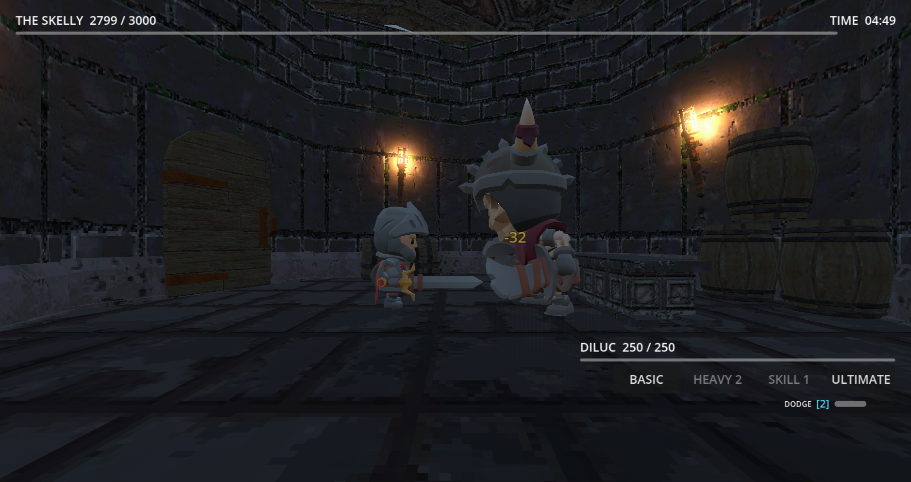
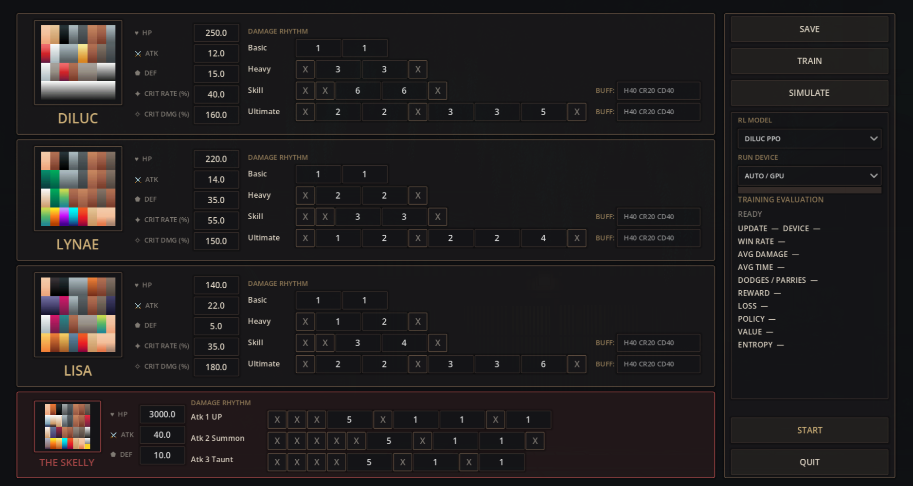
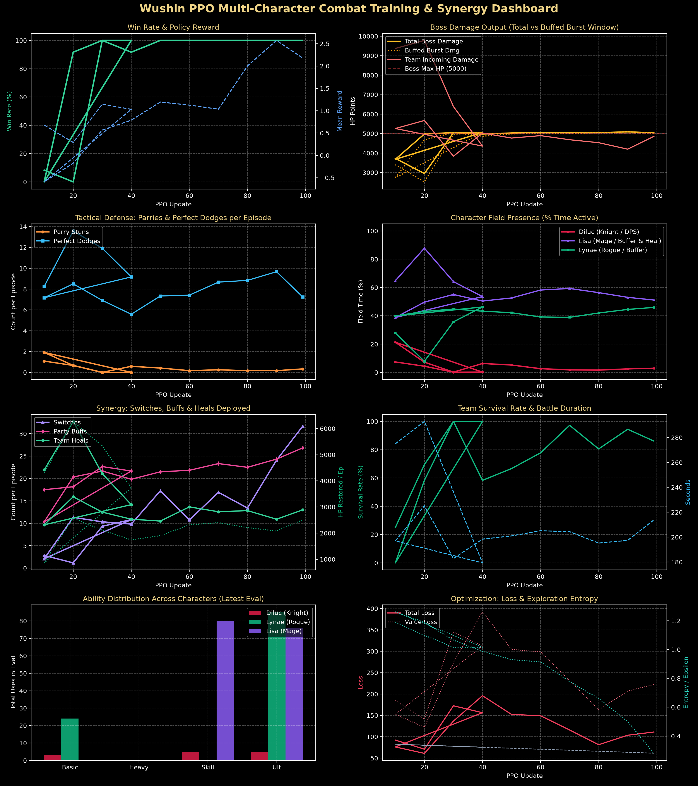
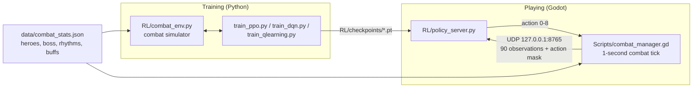

# Team Rotation Optimiser

Reinforcement learning agents that play **Wushin**, a real-time, three-hero boss fight built in **Godot 4.7**. The agent decides once per second whether to attack, switch heroes, dodge or wait. It learns team rotations: Lisa heals and buffs the party, Lynae buffs attack and defence, and Diluc is switched in to burst damage while the buffs last.

Three agents are included: PPO, Dueling Double DQN, and an advantage actor-critic. All three train in a Python copy of the game's combat rules and can then play the real game live through a small UDP policy server.

## Screenshots



*The battle. The HUD shows the boss's HP and the timer at the top, and the active hero's HP, ability cooldowns and dodge charges at the bottom right.*



*The title screen. Every hero's and the boss's stats, damage rhythms and Skill / Ultimate buffs can be edited here. The panel on the right picks the RL model and device, trains it (TRAIN) or lets it play (SIMULATE).*



*PPO training dashboard.*

---

## Contents

- [Screenshots](#screenshots)
- [How it works](#how-it-works)
- [The fight](#the-fight)
- [The RL problem](#the-rl-problem)
- [Algorithms](#algorithms)
- [Repository layout](#repository-layout)
- [Setup](#setup)
- [Usage](#usage)
- [Results](#results)
- [Known limitations](#known-limitations)

---

## How it works



1. **Simulator.** `RL/combat_env.py` reproduces the game's one-second combat tick (attack rhythms, parry, dodge, buffs, heals, switching) without graphics, so training runs far faster than real time.
2. **Training.** A trainer plays thousands of simulated fights and saves the policy to `RL/checkpoints/`.
3. **Playing.** In the game, **SIMULATE** starts `policy_server.py` with the chosen checkpoint. Once per second, `combat_manager.gd` sends the current 90-value observation and a legal-action mask as JSON over UDP. The server replies with the action the network rates highest, and the game performs it.

---

## The fight

Combat resolves once per second. Every move and boss attack is a **rhythm**: a row of one-second slots. A number in a slot is a hit multiplier on the attacker's ATK; `X` is animation only.

| Character | Role | HP | ATK | DEF | Crit | Skill / Ultimate effect |
|---|---|---:|---:|---:|---|---|
| **Diluc** (Knight) | Main damage | 900 | 25 | 10% | 70%, ×1.8 | Ultimate `X 1 1 X 1 2 5 X` |
| **Lisa** (Mage) | Healer / buffer | 2000 | 10 | 20% | 50%, ×1.5 | Skill heals 200; Ultimate heals 300 and gives +30% crit rate and +80% crit damage |
| **Lynae** (Rogue) | Buffer | 1500 | 10 | 30% | 50%, ×1.5 | Ultimate gives +40 ATK and +30 DEF |
| **The Skelly** (boss) | — | 5000 | 100 | 10% | — | 3 random attacks; Summon `X X X X X 3 X 3 3 X` hits hardest |

- **Damage**: multiplier × ATK, then a crit roll, then reduced by the target's defence percentage.
- **Parry**: if one of our hits above 2× lands in the same second as a boss hit, the boss hit is cancelled and the boss is stunned for 4 seconds.
- **Dodge** (Shift): cancels the next boss hit. There are 3 charges, and one comes back every 8 seconds.
- **Switch** (1 / 2 / 3): swaps the hero on the field. Each hero's cooldowns keep ticking while they are on the bench.
- **Cooldowns**: Basic 2 s, Heavy 4 s, Skill 8 s, Ultimate 32 s.
- **Win**: bring the boss to 0 HP within 300 seconds. **Lose**: all three heroes die, or the timer runs out.

All numbers live in `data/combat_stats.json` and can be edited on the title screen. The game and the simulator both read the same file.

---

## The RL problem

| | |
|---|---|
| **State** | 90 values in [0, 1]: boss HP and time; party HP; active hero; each hero's post-buff ATK, DEF and crit stats; team flags (lowest HP, emergency, buff time left, burst-ready); all 12 cooldowns; current attacks and boss move; stun, freeze, dodge charges and active buffs; an immediate-threat flag; and the next 16 seconds of hit multipliers for our attack and for the boss's. The full index table is in [`RL_COMBAT_SYSTEM_REPORT.md`](RL_COMBAT_SYSTEM_REPORT.md). |
| **Actions** | 9: wait, basic, heavy, skill, ultimate, switch to Diluc / Lisa / Lynae, dodge |
| **Action mask** | Illegal actions get zero probability: moves on cooldown, anything while frozen, switching to the active or a dead hero, switching within 3 s of the last switch, and dodging with no charges |
| **Reward** | Damage dealt (with a bonus when Diluc attacks under buffs), parries and successful dodges, effective heals (scaled by how hurt the party is), well-timed rotations, a penalty for damage taken and −35 per hero death, +150 for a win, −100 for a wipe or timeout. The exact terms are in `RL/combat_env.py` and the report. |
| **Episode** | Up to 300 steps of one second each; discount γ = 0.99 |

---

## Algorithms

| Script | Algorithm | Details |
|---|---|---|
| `RL/train_ppo.py` | **PPO** (actor-critic) | Clipped objective (ε = 0.2), GAE (λ = 0.95), 1024 steps per update, 4 full-batch epochs per rollout (one gradient step each), entropy bonus 0.03 decaying over training, ε-greedy exploration from 0.35 to 0.02, action masking |
| `RL/train_dqn.py` | **Dueling Double DQN** | Q(s, a) = V(s) + A(s, a) − mean A; replay buffer 50k; batch 64; soft (Polyak) target updates, τ = 0.005; ε-greedy from 0.5 to 0.02; masked argmax |
| `RL/train_qlearning.py` | **Advantage actor-critic (A2C)** | Residual network; advantage = n-step return (bootstrapped from V at the end of the rollout) − V(s); one gradient step per 1024-step rollout; no clipping. Named *qlearning* in the code and menu, but it is a policy-gradient method. |

Each trainer evaluates the greedy policy on 12 fights every update, can stop early after a winning streak (`--early-stop-streak`), and writes progress as JSON lines for the in-game panel and the plotting script.

---

## Repository layout

```
.
├── project.godot               Godot 4.7 project
├── main.tscn                   battle arena: 3 heroes, boss, camera
├── SimulatorConfig.tscn        title screen: stat editor, TRAIN, SIMULATE, START
├── Scripts/
│   ├── combat_manager.gd       1 s combat tick, damage, parry, dodge, buffs, HUD, RL link
│   ├── player_manage.gd        hero switching and deaths
│   ├── diluc.gd lisa.gd lynae.gd   hero input and animations
│   ├── boss_skelly.gd          boss attack loop
│   └── ui_menu.gd              title screen and training launcher
├── data/combat_stats.json      every stat, rhythm, cooldown and buff
├── RL/
│   ├── combat_env.py           simulator (90 observations, 9 actions, reward)
│   ├── train_ppo.py            PPO trainer
│   ├── train_dqn.py            Dueling Double DQN trainer
│   ├── train_qlearning.py      advantage actor-critic trainer
│   ├── policy_server.py        UDP server that loads any of the three checkpoints
│   ├── evaluate_policy.py      evaluate a PPO checkpoint over many fights
│   ├── plot_training_metrics.py  8-panel training dashboard
│   ├── checkpoints/            diluc_ppo.pt, diluc_dqn.pt, diluc_qlearning.pt
│   └── plots/                  training dashboards
├── RL_COMBAT_SYSTEM_REPORT.md  full technical report
├── assets/ models/ addons/     art, animations, dungeon kit, camera rig
```

---

## Setup

**Requirements:** [Godot 4.7](https://godotengine.org/download) and Python 3.10 or newer.

```bash
git clone https://github.com/JATAYU000/Team_rotation_optimiser.git
cd Team_rotation_optimiser

python -m venv .venv
# Windows
.venv\Scripts\activate
# Linux / macOS
source .venv/bin/activate

pip install -r RL/requirements.txt matplotlib
```

The game starts Python itself for TRAIN and SIMULATE. On Windows it uses `.venv\Scripts\python.exe` if that exists. On other systems it runs `python` from your `PATH`, so activate the virtual environment before launching Godot.

---

## Usage

### In the game

Open the folder in Godot 4.7 and press **Run**, or run `godot --path .` from the repository root. On the title screen:

| Button | What it does |
|---|---|
| **START** | Play yourself: left mouse = Basic, right mouse = Heavy, E = Skill, Q = Ultimate, 1 / 2 / 3 = switch, Shift = dodge |
| **SIMULATE** | Watch the trained agent play, using the model chosen in the dropdown (PPO, DQN or Q-Learning) |
| **TRAIN** | Train the chosen model with the current stats, with a live progress panel. This replaces that model's checkpoint. |
| **SAVE** | Save edited stats and rhythms |

### From the command line

Run these from the repository root:

```bash
# Train
python RL/train_ppo.py --updates 500 --seed 7
python RL/train_dqn.py --updates 500
python RL/train_qlearning.py --updates 500

# Better exploration for PPO (see the note below)
python RL/train_ppo.py --updates 500 --epsilon-start 0 --epsilon-end 0

# Evaluate a PPO checkpoint
python RL/evaluate_policy.py --checkpoint RL/checkpoints/diluc_ppo.pt --episodes 200

# Plot a training run
python RL/plot_training_metrics.py --help

# Serve a policy to the game by hand
python RL/policy_server.py --checkpoint RL/checkpoints/diluc_ppo.pt
```

Every trainer accepts `--stats`, `--output`, `--seed`, `--device {auto,cuda,cpu}`, `--eval-episodes` and `--early-stop-streak`. Run any script with `--help` for the full list.

---

## Results

Results as reported in [`RL_COMBAT_SYSTEM_REPORT.md`](RL_COMBAT_SYSTEM_REPORT.md), measured on the trainers' 12-fight evaluations:

| Agent | Peak win rate | Average clear time | Switches / fight | Heals / fight |
|---|---:|---:|---:|---:|
| Random actions | 0% | 42 s (wipe) | 1.1 | 0.8 |
| Hand-written rotation script | 41.6% | 210 s | 14.2 | 8.5 |
| Dueling Double DQN | 75.0% | 142 s | 6.2 | 14.1 |
| Advantage actor-critic | 83–100% | 128 s | 10.7 | 13.8 |
| **PPO** | **100%** | **94 s** | 9.4 | 11.2 |

The training dashboards for each model are in [`RL/plots/`](RL/plots/).

To reproduce a number with more fights than the in-training evaluation uses:

```bash
python RL/evaluate_policy.py --checkpoint RL/checkpoints/diluc_ppo.pt --episodes 200
```

---

## Known limitations

- **Small evaluations.** Training evaluations use 12 fights, so a single run's win rate moves in steps of about 8%. Report final numbers over 200 or more fights and several seeds.
- **Simulator timing.** The simulator starts boss attacks on a fixed 5-second grid. In the game, boss timing comes from animations (about 11.7 s to the first attack and about 4 s between attacks). Compare SIMULATE results with the simulator before relying on them.
- **ε-greedy inside PPO.** PPO already explores by sampling from its policy. The random ε actions are stored with the policy's own log-probability, which biases the PPO update. In a test on the previous version of this code, two seeds trained with `--epsilon-start 0 --epsilon-end 0` reached 95–96% wins over 200 fights after 300 updates, against 12% and 66% with the default ε.
- **Discrete 1-second decisions.** The agent acts once per tick, while the game's animations run continuously.
- **Fixed team.** The observation is built for exactly these three heroes.
