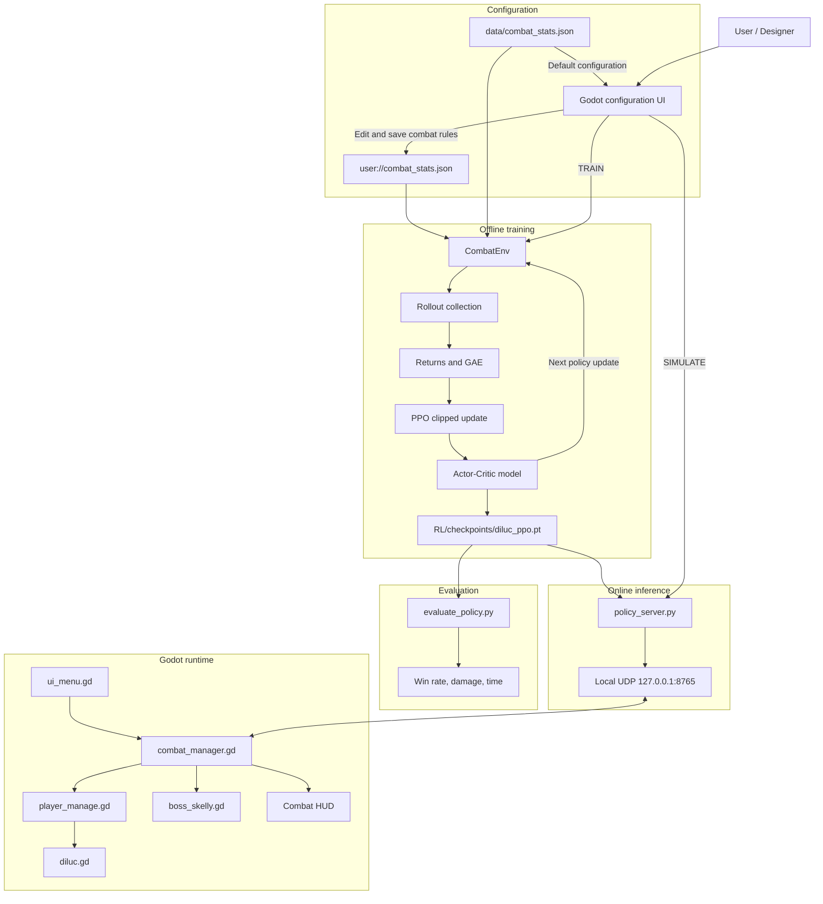

# Diluc PPO Combat Simulator

This folder contains the reinforcement-learning component of the Godot combat
simulator. It includes:

- A headless, one-second combat environment.
- A deep actor-critic PPO trainer.
- Checkpoint evaluation tools.
- A local UDP policy server used by the Godot visual simulation.

The headless environment reads the same JSON configuration edited by the Godot
configuration screen. This keeps training rules separate from rendering while
preserving a shared combat model.

## Project status

### Implemented

- Discrete combat actions for waiting, attacks, and character switching.
- Normalized observations containing HP, cooldowns, attack progress, boss state,
  and upcoming rhythm tokens.
- Action masking for actions that are physically invalid.
- Explicit penalties for selecting attacks during cooldown.
- Reward shaping for damage, survival, waiting, switching, defeat, victory, and
  timeout.
- PPO actor-critic training with GAE, clipped policy updates, entropy
  regularization, evaluation, checkpoint saving, and device selection.
- Greedy checkpoint inference through the local UDP policy server.

### Current limitations

- Only Knight/Diluc attack behavior is implemented in the RL environment.
- Mage/Lisa and Rogue/Lynae are represented for HP and switching, but do not
  yet have their own learned attack rotations.
- Buff values can be stored by the UI, but are not yet fully applied to the
  combat transition and damage calculations.
- The current policy is feed-forward and does not have recurrent memory.

## Why PPO?

PPO was selected as the first baseline because this combat problem has:

- A discrete action space: Basic, Heavy, Skill, Ultimate, Wait, and Switch.
- A continuous, changing state: HP, cooldowns, attack timing, boss state, and
  damage values.
- Delayed outcomes: an action can affect survival or victory several seconds
  later.
- Invalid actions that can be masked.

PPO is a suitable first algorithm because it learns a neural-network policy,
uses an actor-critic structure for long-term credit assignment, and limits how
far the policy can change after each rollout. The goal is to establish a
reliable baseline before comparing other algorithms.

## Markov Decision Process

The environment models combat as a discrete-time Markov Decision Process
(MDP). One environment step represents one second of combat.

At each timestep:

```text
observation -> policy network -> action -> combat transition -> reward
```

An episode ends when:

- The boss is defeated.
- The whole team is defeated.
- The battle timer expires.

### Observation/state

Every observation is a fixed-size floating-point vector containing:

- Boss HP ratio, remaining time, and elapsed time.
- HP ratios for Knight, Mage, and Rogue.
- Active-character one-hot encoding.
- Basic, Heavy, Skill, and Ultimate cooldowns.
- Last outgoing and incoming damage.
- Player attack-active flag and attack progress.
- Boss attack type: Up, Summon, or Taunt.
- Boss attack progress and active flag.
- Future numeric hit slots for the current player and boss rhythms.

Values are normalized where appropriate so that HP, cooldowns, timers, and
damage features have comparable scales.

### Action space

| ID | Action |
|---:|---|
| 0 | Wait |
| 1 | Diluc Basic |
| 2 | Diluc Heavy |
| 3 | Diluc Skill |
| 4 | Diluc Ultimate |
| 5 | Switch to Knight |
| 6 | Switch to Mage |
| 7 | Switch to Rogue |

The current RL version executes Knight/Diluc attacks. Mage and Rogue remain in
the action and state schema so the environment can be extended consistently.

### Action masking

Action masking prevents actions that are physically invalid. For example,
starting another attack while an attack animation is already active is masked
out and receives effectively zero probability.

Cooldown actions are deliberately different. An attack whose cooldown has not
expired remains selectable, but produces a negative reward. This gives PPO a
learning signal instead of hiding the decision:

```text
Invalid during an active attack -> masked
Skill selected during Skill cooldown -> allowed but penalized
```

### Reward

The reward is designed to balance damage, survival, and efficient decision
making:

- Positive reward proportional to boss damage.
- Large positive reward for victory.
- Negative reward for incoming damage.
- Negative reward for defeat.
- Negative reward for timeout.
- Penalty for invalid actions.
- Penalty for selecting an attack during its cooldown.
- Small penalty for waiting while a useful move is ready.
- Small cost for unnecessary switching.
- Small per-step time cost.

Conceptually:

```text
reward =
    damage reward
  + victory reward
  - incoming damage penalty
  - cooldown misuse penalty
  - idle/switch/time penalties
```

The agent is not given a fixed attack script. It learns which actions produce
better long-term reward in each observed combat state.

## PPO architecture

PPO means **Proximal Policy Optimization**. The implementation is in
`train_ppo.py`.

### Actor-critic network

The network uses a shared two-layer body:

```text
observation
    |
Linear(observation_size, 256)
    |
Tanh
    |
Linear(256, 256)
    |
Tanh
    |
    +--> Policy head: one logit per action
    |
    +--> Value head: estimated state value
```

The value `256` is a model-capacity hyperparameter, not a PPO requirement. It
provides enough capacity to learn interactions between cooldowns, HP, attack
rhythms, and boss behavior. Smaller sizes such as 64 or 128 may be tested later
for speed, but changing the architecture requires retraining the checkpoint.

### Actor/policy

The actor outputs one logit for every action. The logits are converted into a
categorical probability distribution:

```text
Basic:    0.30
Heavy:    0.15
Skill:    0.10
Ultimate: 0.35
Wait:     0.10
Switch:   0.00
```

During training, an action is sampled from this distribution to encourage
exploration. During evaluation and Godot simulation, the highest-probability
valid action is selected.

### Critic/value function

The critic estimates the expected future reward from the current state:

```text
V(state) = expected discounted future return
```

The critic does not select actions. It provides a baseline for deciding
whether the actor's selected action performed better or worse than expected.

## How one PPO update works

### 1. Collect a rollout

The current policy plays for a fixed number of steps, currently 1024 by
default. For each step, the trainer stores:

- Observation.
- Selected action.
- Reward.
- Old action log-probability.
- Critic value estimate.
- Done flag.
- Action mask.

### 2. Calculate discounted returns

Future rewards are discounted with:

```text
gamma = 0.99
```

This allows the agent to value delayed outcomes such as saving Ultimate for a
later opportunity or surviving long enough to defeat the boss.

### 3. Calculate advantages with GAE

The temporal-difference error is:

```text
delta = reward + gamma * next_value - current_value
```

The implementation uses Generalized Advantage Estimation (GAE):

```text
gae_lambda = 0.95
```

The advantage answers:

```text
Was this action better or worse than the critic expected?
```

Positive advantage increases an action's probability. Negative advantage
decreases it.

### 4. Apply the PPO clipped objective

The policy compares the new probability of the recorded action with its old
probability:

```text
ratio = new_probability / old_probability
```

With the current clip value:

```text
clip = 0.20
```

the useful ratio range is approximately:

```text
0.80 to 1.20
```

If an action was good, PPO increases its probability, but prevents an
unusually large jump. If an action was bad, PPO decreases its probability
without destabilizing the whole policy.

### 5. Update actor and critic

The total loss combines:

```text
policy loss
+ value coefficient * value loss
- entropy coefficient * entropy
```

The current defaults are:

| Hyperparameter | Value |
|---|---:|
| Rollout steps | 1024 |
| PPO epochs | 4 |
| Learning rate | 0.0003 |
| Gamma | 0.99 |
| GAE lambda | 0.95 |
| Clip range | 0.20 |
| Value coefficient | 0.50 |
| Entropy coefficient | 0.01 |
| Maximum gradient norm | 0.50 |

Entropy encourages exploration so that the agent does not immediately commit
to one action such as repeatedly using Skill.

## Example learning behavior

Suppose the state is:

```text
Boss HP: 50%
Diluc HP: 80%
Basic: ready
Heavy: ready
Skill: 3 seconds remaining
Ultimate: ready
```

If the agent selects Skill, it receives a cooldown penalty and likely obtains
a negative advantage. PPO gradually makes Skill less likely in similar states.

If it selects Basic, deals damage, and avoids the cooldown penalty, it may
receive a positive advantage. PPO then makes Basic more likely in similar
states.

After many rollouts, the policy can learn behavior such as:

- Use Basic or Heavy while Skill is cooling down.
- Use Skill when it becomes available.
- Reserve Ultimate for a favorable timing window.
- Avoid unnecessary waiting.
- Avoid taking avoidable incoming damage.

This is learned behavior, not a manually written rotation.

## Training and evaluation

Install dependencies from the project root:

```powershell
pip install -r RL/requirements.txt
```

Run a smoke test:

```powershell
python -c "from RL.combat_env import CombatEnv, load_stats; e=CombatEnv(load_stats('data/combat_stats.json')); print(e.observation_size, e.step(1)[1])"
```

Train a policy:

```powershell
python RL/train_ppo.py --stats data/combat_stats.json --updates 500
```

The default checkpoint is written to:

```text
RL/checkpoints/diluc_ppo.pt
```

Evaluate a checkpoint:

```powershell
python RL/evaluate_policy.py --stats data/combat_stats.json --checkpoint RL/checkpoints/diluc_ppo.pt --episodes 100
```

Training can select a device explicitly:

```powershell
python RL/train_ppo.py --device auto
python RL/train_ppo.py --device cpu
python RL/train_ppo.py --device cuda
```

`auto` uses CUDA when the installed PyTorch build supports it; otherwise it
falls back to CPU. Forced CUDA reports an error if CUDA is unavailable.

## Godot integration

The Godot title screen's **SIMULATE** button starts the local UDP inference
server and opens the visual battle.

The integration flow is:

```text
Godot combat state
    -> observation + action mask over UDP
    -> policy_server.py
    -> selected action over UDP
    -> Godot animation/cooldown/damage/switch logic
```

The policy server uses greedy inference. It does not train during simulation.
Godot remains responsible for visual animation and live combat presentation.

## Planned algorithm comparison

PPO is the first implemented baseline. Future comparisons should use the same:

- Environment.
- Observation space.
- Action space.
- Reward function.
- Training budget.
- Random seeds.
- Evaluation episodes.

Candidate alternatives are:

### DQN

DQN learns an action-value function:

```text
Q(state, action)
```

It is suitable for discrete actions, but requires careful handling of replay
data, invalid-action masking, delayed rewards, and changing combat states.

### Recurrent PPO

Recurrent PPO adds an LSTM or GRU to the policy:

```text
current observation + hidden memory -> action
```

It may help if important information is only available through timing history,
hidden boss phases, or partially observed behavior. The current feed-forward
environment exposes much of its relevant state directly, so recurrent memory
is a planned extension rather than a current requirement.

### Comparison metrics

| Metric | PPO | DQN | Recurrent PPO |
|---|---:|---:|---:|
| Win rate |  |  |  |
| Average damage |  |  |  |
| Average survival time |  |  |  |
| Cooldown misuse count |  |  |  |
| Switching mistakes |  |  |  |
| Timeout/defeat rate |  |  |  |
| Training time |  |  |  |
| Training stability |  |  |  |

The purpose is not to assume that one algorithm is always best. The purpose is
to measure which method works best for this combat scenario.

## Presentation summary

> We model combat as a discrete Markov Decision Process. At every one-second
> timestep, the observation contains normalized boss and character HP,
> cooldowns, attack timing, boss state, recent damage, and upcoming rhythm
> tokens. The actor network outputs logits over discrete actions, while the
> critic estimates the expected future return. We collect rollouts, calculate
> Generalized Advantage Estimates, and update the actor with PPO's clipped
> probability ratio. The critic uses value loss, and entropy regularization
> encourages exploration. Invalid actions are masked, while cooldown actions
> remain selectable and receive a penalty so the agent learns not to waste
> turns on unavailable abilities.

PPO is currently the baseline. Recurrent PPO and DQN can be implemented later
and compared using identical environment rules and evaluation metrics.

## End-to-end system design

The project has two operating modes:

1. **Training mode** uses the headless Python environment to learn a PPO policy.
2. **Simulation mode** loads the trained policy into a local UDP server and uses
   it to control the visual Godot combat scene.

The complete system is organized as follows:



### Component responsibilities

| Component | Responsibility |
|---|---|
| `data/combat_stats.json` | Default boss, character, cooldown, damage, and rhythm configuration |
| `user://combat_stats.json` | User-saved configuration selected by the Godot UI |
| `combat_env.py` | Headless one-second combat MDP used for training and evaluation |
| `train_ppo.py` | Rollout collection, GAE calculation, PPO optimization, and checkpoint saving |
| `evaluate_policy.py` | Deterministic checkpoint evaluation and metric reporting |
| `policy_server.py` | CPU-loaded greedy policy inference over local UDP |
| `ui_menu.gd` | Saves configuration and starts training or simulation processes |
| `combat_manager.gd` | Godot combat state, RL observations, action masks, UDP requests, damage, and HUD |
| `player_manage.gd` | Active-character switching, death handling, and switch animations |
| `diluc.gd` | Player attack animation states, input handling, and character cooldown timers |
| `boss_skelly.gd` | Boss idle loop and random boss attack animation selection |

### Training data flow

```text
Combat configuration
        |
        v
CombatEnv.reset()
        |
        v
Normalized observation
        |
        v
Masked actor-critic policy
        |
        v
Sampled action
        |
        v
CombatEnv.step(action)
        |
        v
Reward + next observation + done flag
        |
        v
Rollout buffer
        |
        v
Returns and GAE advantages
        |
        v
PPO clipped actor/critic update
        |
        v
Saved PyTorch checkpoint
```

The trainer stores the observation, selected action, reward, old log
probability, value estimate, terminal flag, and action mask for each rollout
step. The default rollout contains 1024 steps.

### Runtime inference data flow

When the user presses **SIMULATE**, `ui_menu.gd` starts
`policy_server.py`, loads the PPO checkpoint, enables RL simulation mode, and
opens the Godot combat scene.

```text
Godot combat_manager.gd
        |
        | JSON: request ID, observation, action mask
        v
UDP 127.0.0.1:8765
        |
        v
policy_server.py
        |
        v
Actor network + action mask
        |
        v
Greedy valid action
        |
        | JSON: request ID, action
        v
Godot combat_manager.gd
        |
        v
Attack, wait, or character switch
        |
        v
Animation, cooldown, damage, HP, and HUD update
```

Godot requests a decision approximately once per second. The request ID
prevents a delayed UDP response from being applied to a newer request. The
server performs inference only; it does not train the model during simulation.

### MDP system design

The Python environment and the Godot combat manager use the same conceptual
state-transition loop:

```text
Observation -> Policy -> Action -> Combat transition -> Reward -> Next observation
```

One Python environment step represents one second. A transition performs these
operations:

1. Apply the selected wait, attack, or switch action.
2. Start or advance the player attack rhythm.
3. Start or advance the boss attack rhythm.
4. Resolve numeric rhythm tokens into damage.
5. Decrease ability cooldowns.
6. Advance the combat timer.
7. Calculate the shaped reward.
8. Check victory, defeat, or timeout.
9. Return the next observation and diagnostic information.

An episode terminates when the boss is defeated, the entire team is defeated,
or the battle timer expires.

### Observation pipeline

The observation is a fixed-size vector of normalized floating-point features.
Its groups are:

```text
Boss HP, remaining time, elapsed time
Knight, Mage, and Rogue HP ratios
Active-character one-hot encoding
Basic, Heavy, Skill, and Ultimate cooldowns
Last outgoing and incoming damage
Player attack active flag and progress
Boss attack type, progress, and active flag
Padded upcoming player and boss rhythm tokens
```

The Python environment produces this vector in `_observation()` and Godot
produces the corresponding runtime vector in `_rl_observation()`. Numeric
rhythm tokens represent future hit multipliers; `X` and `_` represent
animation-only timing slots.

### Action and masking pipeline

The policy has eight discrete actions:

| ID | Action |
|---:|---|
| 0 | Wait |
| 1 | Diluc Basic |
| 2 | Diluc Heavy |
| 3 | Diluc Skill |
| 4 | Diluc Ultimate |
| 5 | Switch to Knight |
| 6 | Switch to Mage |
| 7 | Switch to Rogue |

The action mask removes actions that are physically impossible, such as
starting an attack while another attack is active or switching to a defeated
character:

```text
Actor logits + action mask
        |
        v
Invalid logits replaced with a very negative value
        |
        v
Categorical distribution over valid actions
```

Cooldown misuse is intentionally not always masked. Selecting an attack while
its cooldown is active remains a possible decision and receives a negative
penalty. This lets PPO learn that the decision is strategically poor instead of
simply hiding it.

### Reward and transition objectives

The reward is designed to balance damage, survival, and efficient decisions:

```text
Reward =
    boss damage reward
  + victory reward
  - incoming damage penalty
  - invalid-action penalty
  - cooldown misuse penalty
  - idle-while-ready penalty
  - switching penalty
  - per-step time cost
```

The current terminal rewards are:

| Event | Reward effect |
|---|---:|
| Boss defeated | `+100` |
| Team defeated | `-100` |
| Battle timeout | `-25` |
| Boss damage | Positive, proportional to normalized damage |
| Incoming damage | Negative, proportional to normalized damage |

### PPO learning architecture

```text
Observation vector
        |
Linear(observation_size, 256)
        |
Tanh
        |
Linear(256, 256)
        |
Tanh
        |
      Shared representation
        |
        +--------------------+
        |                    |
        v                    v
Policy head              Value head
8 action logits           V(state)
```

The actor selects actions. The critic estimates the expected discounted future
return. During training, the actor samples from the masked categorical
distribution. During evaluation and Godot simulation, the highest-probability
valid action is selected.

The PPO update uses:

```text
delta = reward + gamma * next_value - current_value
GAE lambda = 0.95
ratio = new_action_probability / old_action_probability
clipped ratio range = 0.80 to 1.20
total loss = policy loss + value coefficient * value loss
             - entropy coefficient * entropy
```

The current defaults are:

| Hyperparameter | Value |
|---|---:|
| Rollout steps | 1024 |
| PPO epochs | 4 |
| Learning rate | `0.0003` |
| Discount factor (`gamma`) | `0.99` |
| GAE lambda | `0.95` |
| Clip range | `0.20` |
| Value coefficient | `0.50` |
| Entropy coefficient | `0.01` |
| Maximum gradient norm | `0.50` |

### Evaluation and extension points

Evaluation runs the checkpoint over seeded episodes and reports:

- Win rate
- Average battle duration
- Average damage
- Timeout and defeat behavior

For a fair future comparison between PPO, DQN, and Recurrent PPO, keep the
following fixed:

- Environment rules
- Observation space
- Action space
- Reward function
- Training budget
- Random seeds
- Evaluation episodes

Current implementation limitations are:

- Only Knight/Diluc attacks are executed by the Python RL environment.
- Mage/Lisa and Rogue/Lynae are present in the state and switching schema but
  do not yet have independent learned attack rotations.
- Buff values can be stored by the UI but are not fully applied to combat
  transitions and damage calculations.
- The policy is feed-forward and currently has no recurrent memory.
- Training and Godot runtime combat are separate implementations and should be
  kept synchronized when combat rules change.
